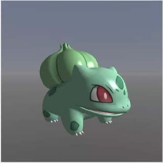
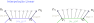

# Iluminação Dinâmica

Vamos iluminar um modelo 3D para exercitar a **iluminação dinâmica**. Em vez de
a cor de cada pixel vir "pronta" da textura do modelo (o *albedo*), ela passa a
ser calculada nos shaders a partir de uma luz, da posição da câmera e da
orientação (normal) da superfície naquele ponto.

A cena mostra um modelo glTF (em `models/`, à sua escolha no seletor) com uma 
câmera controlada pelo mouse e uma luz pontual (posição coincidindo com 
uma esfera branca pequena). Você pode:

- girar a câmera arrastando o mouse e usar a roda para dar zoom
- apertar <kbd>W</kbd> (ou usar o checkbox) para mostrar/ocultar o _wireframe_
- ajustar a cor da luz e os coeficientes ambiente, difuso, especular e o brilho.

## Modelos de iluminação baseados em Phong

Seguindo o modelo de materiais de Phong, a cor final de um fragmento 
é a soma de três componentes (cada uma multiplicada
pela cor da luz). Considere os vetores **normalizados** (todos saindo do ponto
da superfície):

- $\hat{n}$: normal da superfície em um ponto $P$:
- $\hat{l}$: vetor incidência da luz (de $P$ até a fonte)
- $\hat{v}$: vetor visualização (de $P$ até a câmera)
- $\hat{r}$: vetor reflexão perfeita da luz
- $\hat{n}$: vetor "meio do caminho" (*half-vector*) entre $\vec{l}$ e $\vec{v}$

Considere também as caraterísticas de fontes de luz e material:

- $k_a$: coeficiente de iluminação ambiente
- $k_d$: coeficiente de iluminação difusa
- $k_e$: coeficiente de iluminação especular
- $e$: expoente de especularidade
- $L$: cor da fonte de luz (normalmente branca)
- $\text{albedo}$: cor da "tinta" usada para "pintar" o objeto 
  (proveniente da textura)

Considere também a equação do modelo de iluminação de Phong para determinar
a cor $C(P)$ resultante em um ponto $P$, e suas componentes:

$$
C(P)=C_{amb}+C_{dif}+C_{esp}
$$ 

| Componente | Cálculo                                                    |
|------------|------------------------------------------------------------|
| Ambiente $C_{amb}$  | $k_a \times L \times \text{albedo}$                      |
| Difusa $C_{dif}$    | $k_d \times \hat{n}\cdot\hat{l} \times L \times \text{albedo}$  |
| Especular $C_{esp}$ | $k_s \times \hat{r}\cdot\hat{v} \times L$                            |

Além do modelo de Phong, que calcula a equação de Phong para cada fragmento,
há outros semelhantes. Em geral, a diferença entre as técnicas está em
**onde** e **como** a conta é feita:

1. **Gouraud**: a iluminação é calculada no *vertex shader*, por vértice, e a
   cor resultante é interpolada para os fragmentos. É barato, mas perde
   brilhos que "caem" no meio de um triângulo.
1. **Phong**: o *vertex shader* só repassa a normal e a posição em espaço do
   mundo ou da câmera e a iluminação é calculada no *fragment shader*, por
   fragmento, com a normal interpolada (e renormalizada¹!). A componente especular é calculada com $\hat{r}\cdot\hat{v}$.
   

     
¹Renormalizada

     

       

         É necessário renormalizar o vetor normal ao chegar no fragment
         shader porque ao ser interpolado pela <em>varying</em>, ele pode
         ficar com magnitude menor do que 1.  
       

       

         Se fosse possível configurar, faríamos uma interpolação esférica.
         Como não é, basta renormalizar o vetor normal.
       

       
     

   

1. **Blinn-Phong**: igual ao Phong, mas o especular usa $\hat{n}\cdot\hat{h}$ no lugar de
   $\hat{r}\cdot\hat{v}$. É mais barato e costuma ter um brilho mais suave.

## Exercício

Você deve fazer a atividade nos arquivos `vertex.glsl` e `fragment.glsl`,
que hoje desenham apenas o albedo (sem iluminação, a opção "Albedo" do
seletor). Se quiser, dê uma olhada também no `main.vanilla.js` para ver como 
os uniformes são enviados aos shaders. Mas todo o exercício será feito em
`vertex.glsl` e `fragment.glsl`.

Os uniformes disponíveis são:

| Uniforme            | Tipo        | Descrição                                  |
|---------------------|-------------|--------------------------------------------|
| `u_model`           | `mat4`      | modelo → mundo                             |
| `u_view`            | `mat4`      | mundo → câmera                             |
| `u_projection`      | `mat4`      | câmera → clip                              |
| `u_texture`         | `sampler2D` | textura de cor (albedo)                    |
| `u_baseColor`       | `vec4`      | fator de cor do material                   |
| `u_lightPosition`   | `vec3`      | posição da luz (espaço de mundo)           |
| `u_lightColor`      | `vec3`      | cor da luz                                 |
| `u_cameraPosition`  | `vec3`      | posição da câmera (espaço de mundo)        |
| `u_ambient`         | `float`     | `ka`: intensidade ambiente                 |
| `u_diffuse`         | `float`     | `kd`: intensidade difusa                   |
| `u_specular`        | `float`     | `ks`: intensidade especular                |
| `u_shininess`       | `float`     | `e`: brilho (expoente especular)           |

ℹ️ Os atributos dos vértices têm localização fixa:
`layout(location = 0) in vec3 a_coords`, `location = 1` para `a_normal` e
`location = 2` para `a_texcoord`. Todos os cálculos de iluminação devem ser
feitos no **espaço de mundo**.

Vamos lá:

- Exercício 0: Brilhos no Gouraud
    - Abra a página e veja o resultado obtido pelas implementações 
      de referência: Gouraud, Phong e Blinn-Phong. Tente ver as diferenças
      visuais entre eles.
    - Em particular, veja o **Voltorb com Gouraud**. Repare no brilhinho 
      especular. Tente explicar o que está acontecendo, com um 
      comportamento no rosto dele vs nos lados e costas. 
      Ative o modo de arame com <kbd>w</kbd>. Pergunta-se:
      - Por quê o brilhinho fica esquisito em alguns momentos com Gouraud?
      - Por que isso não acontece se você escolher Phong ou Blinn-Phong?
- Exercício 1: Luz Ambiente
    - Em `fragment.glsl`, declare os uniformes `u_lightColor` e `u_ambient` e
      devolva a componente ambiente em vez do albedo puro. Repare que o modelo
      todo fica "chapado": não há noção de forma ainda.
- Exercício 2: Luz Difusa (Phong)
    - Use `v_normal` e `v_worldPos` (já repassados pelo vertex shader) e
      calcule `n` e `l` no fragment shader. **Normalize** a normal interpolada.
    - Some a componente difusa. Use `max(..., 0.0)` para evitar "luz negativa".
    - Dica: `u_lightPosition` e `v_worldPos` estão no mesmo espaço (do mundo).
- Exercício 3: Luz Especular (Phong)
    - Calcule `v` com `u_cameraPosition` e `R` com `reflect(-l, n)`.
    - Some o especular, `pow(max(dot(r, v), 0.0), u_shininess)`.
    - Teste variar o brilho `n` e o `ks` na interface. Olhe o modelo girando:
      o brilho acompanha a câmera.
- Exercício 4: Blinn-Phong
    - Troque `r · v` por `n · h`. Compare as duas versões.
- Desafio 1: _Cell shading_
    - Desenhos animados 2D, quando representam o sombreamento nos personagens,
      tipicamente possuem "células": ou um pedaço do personagem está iluminado
      ou não está (2 células). Phong/Gouraud geram um gradiente de iluminação.
      Crie um novo _shader_ (cell.{vertex|fragment}.glsl) que implemente um
      _cell shading_ de 2 ou 3 células.
    - A ideia é algo do tipo: se o ângulo entre normal/luz está entre 0 e 45º,
      o fragmento está iluminado. Se é maior que 45º, não está. 
- Desafio 2: Atenuação
    - Faça a luz perder intensidade com a distância, por exemplo
      `1.0 / (1.0 + k * distancia²)`.

Para conferir seu resultado, os arquivos `gouraud.*`, `phong.*` e
`blinn-phong.*` (`.vertex.glsl` e `.fragment.glsl`) são implementações de
referência, selecionáveis na interface. Só espie **depois** de tentar. 😉
Prefira conversar com os colegas e com o professor antes de visualizar
esses arquivos.

ℹ️ Observação: estamos usando o utilitário matemático da
TWGL.js. Em particular, para matrizes 4x4 ([m4][m4-docs]) e
para ponto/vetor de 3 dimensões ([v3][v3-docs]).

## Créditos

- Modelo [Durant](https://sketchfab.com/3d-models/e6109cc6b0f941848ea18d6a9e5913c6)
  por A110082003, licença [CC-BY-4.0](http://creativecommons.org/licenses/by/4.0/).
- Modelo [Voltorb](https://sketchfab.com/3d-models/voltorb-cd8079ed3d664a738b6c694504e2ef28)
  por nguyenlouis32, licença CC-BY-4.0.
- Os modelos usam compressão Draco; o decodificador em `vendor/draco/` vem do
  [three.js](https://github.com/mrdoob/three.js) (Apache-2.0, Google Draco).

[m4-docs]: https://twgljs.org/docs/module-twgl_m4.html
[v3-docs]: https://twgljs.org/docs/module-twgl_v3.html
